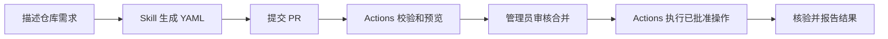

<div align="center">

# gevico / repos

**用一句话申请仓库，通过一次 PR 完成审核。**

GitHub Actions 创建、Fork 和镜像复制仓库，配置权限，归档和删除仓库，并核验每次执行的结果。

[开始申请](#用日常语言申请) · [配置字段](automation/docs/requesting.md) · [管理员配置](automation/docs/setup.md) · [运行与恢复](automation/docs/operations.md)

</div>

---

## 用日常语言申请

克隆仓库，在支持仓库 skill 的编码助手中打开项目：

```bash
git clone https://github.com/gevico/repos.git
cd repos
npm --prefix automation ci
```

调用 `$repo-request`，直接描述你的需求：

> 在 gevico 下创建 qemu-plugins，用来研究 QEMU 插件。仓库设为公开，由 zevorn 管理。

仓库中的 [repo-request skill](.agents/skills/repo-request/SKILL.md) 会读取管理政策，生成 `repositories/qemu-plugins.yaml` 并运行校验。需要提交申请时，告诉助手“把这个申请提交为 PR”。

`repo-request` 使用当前编码助手理解自然语言。CI 根据审核后的 YAML 执行仓库管理。

## 从申请到执行



每个仓库对应一份配置。权限调整也通过修改同一个文件并提交 PR 完成。

## 管理已有仓库与生命周期

| 需求 | 配置与操作 |
| --- | --- |
| 创建仓库 | 在 `repositories/` 提交新 YAML；可选择 README 模板和许可证 |
| Fork 仓库 | 指定真实来源和 `mode: fork`，建立 Fork 关联并配置权限 |
| 镜像复制仓库 | 指定政策允许主机上的 HTTPS 来源和 `mode: mirror`，一次性复制分支与标签 |
| 为已有仓库申请权限 | 用 `mode: existing` 登记真实仓库 ID，保留现有内容与设置 |
| 归档仓库 | 移动 YAML 到 `repositories/archive/`，设置 `status: archived` |
| 删除仓库 | 在归档目录设置 `status: deleted`，保留 YAML 与执行记录 |
| 恢复归档仓库 | 将 YAML 移回 `repositories/`，设置 `status: active` |

可以对 `$repo-request` 说“给 GW100 申请 bbbbbq 的管理权限”“Fork octocat/Hello-World 到 gevico”“把 gitlab.com 上的 QEMU 镜像到 gevico”或“删除 demo”。助手查询真实 ID、保留已有字段，并生成申请。生命周期申请单独提交 PR，管理员审核预览中的准确目标后合并。[查看归档与删除规则](automation/docs/lifecycle.md)

## 一份清晰的申请

```yaml
name: qemu-plugins
description: QEMU 插件研究与实验
visibility: public
topics:
  - qemu
access:
  users:
    zevorn: admin
  teams: {}
```

这是配置格式示例。实际申请中的名称、维护负责人和权限来自用户描述及组织政策。当前管理账号 `zevorn` 保留管理权限。

可用角色为 `pull`、`triage`、`push`、`maintain` 和 `admin`。团队使用现有组织团队的 slug。模板来源和可选许可证由管理员清单控制；新仓库也可以不带许可证。[查看字段与权限说明](automation/docs/requesting.md)

## Actions 执行仓库管理

- **Check**：校验申请文件、运行程序测试，并检查 Terraform 配置。
- **Request**：读取 PR 中的 YAML 数据，检查真实 GitHub 身份、名称和模板，展示变更预览。
- **Apply**：合并后使用 Terraform 创建仓库、设置默认分支与权限、配置分支规则，并通过 GitHub API 核验。Fork 和镜像仓库先完成初始化和内容复制，再由 Terraform 登记。
- **Credentials**：每天检查跨组织 Fork 的用户令牌，失效时创建 Issue 并提及 `@zevorn`。

工作流运行在 GitHub 托管 runner。GitHub App 提供组织访问权限，任务内生成临时令牌。Terraform 状态使用 SOPS/age 加密，保存在私有仓库 `gevico/repos-state`。PR 预览记录加密保存到 Actions artifacts；执行任务核验记录来源后，将记录保存到私有状态仓库。全部运行和存储使用 GitHub 资源。

管理员先完成 [部署配置](automation/docs/setup.md)。仓库申请开始执行的条件是 `AUTOMATION_ENABLED=true`，以及有效的 App 凭证、私有状态仓库和加密密钥。`gevico` 当前使用 GitHub Free；私有目标仓库需要先具备分支保护能力，再更新已核实的组织政策。

## 目录与文件

| 位置 | 内容 |
| --- | --- |
| [`automation/`](automation/) | 管理程序、Terraform、Schema、政策、测试与全部文档 |
| `repositories/` | 可写仓库的 `<name>.yaml` 声明 |
| `repositories/archive/` | 归档与删除仓库的 YAML 声明 |
| `README.md` | 项目入口与申请流程 |

GitHub 从 `.github/` 发现工作流和审核配置，编码助手从 `.agents/skills/` 发现仓库 skill。这两个目录保留在项目根目录。

## 本地使用

生成并校验 YAML：

```bash
npm --prefix automation run request -- \
  --name qemu-plugins \
  --description "QEMU 插件研究与实验" \
  --maintainer zevorn
```

命令将 YAML 输出到终端。编码助手通过文件编辑工具保存申请。

```bash
npm --prefix automation run validate
npm --prefix automation run validate -- --online
npm --prefix automation run check
```

在线校验使用 `GH_TOKEN`、`GITHUB_TOKEN` 或本地 `gh` 登录。它查询用户、团队与模板。仓库创建由审核合并后的 Actions 执行。

生成已有仓库权限申请、镜像申请，或选择初始化内容：

```bash
npm --prefix automation run existing -- --name GW100 --user bbbbbq:admin
npm --prefix automation run lifecycle -- --name demo --status deleted
npm --prefix automation run request -- \
  --name qemu-mirror --description "QEMU 上游代码镜像" \
  --maintainer zevorn --mirror https://gitlab.com/qemu-project/qemu.git
npm --prefix automation run request -- \
  --name project-study --description "项目研究与实验" \
  --maintainer zevorn --readme-template project --license mit
```

## 文档与贡献

- [申请仓库和修改权限](automation/docs/requesting.md)
- [归档、删除和恢复仓库](automation/docs/lifecycle.md)
- [配置 GitHub App、状态仓库和加密密钥](automation/docs/setup.md)
- [执行结果、冲突、导入与恢复](automation/docs/operations.md)
- [已执行的验证](automation/docs/verification.md)
- [文档编写规范](automation/docs/documentation-guidelines.md)
- [贡献流程](.github/CONTRIBUTING.md)

申请文件、政策和工作流由 [CODEOWNERS](.github/CODEOWNERS) 指定的管理员审核。程序使用 [Terraform GitHub Provider](https://github.com/integrations/terraform-provider-github) 管理资源。[MIT License](LICENSE)
