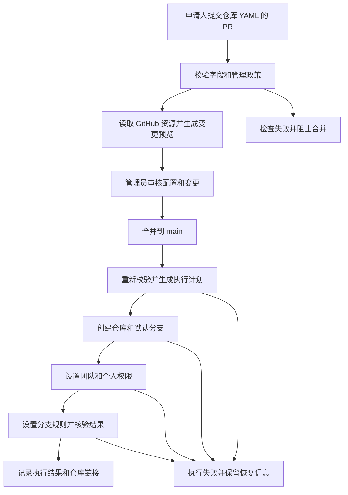

# gevico/repos 实施计划

## 目标

在 `gevico` 组织建立 `repos` 管理仓库。申请人使用仓库中的 `repo-request` skill 描述需求，助手生成并校验 YAML，然后通过 PR 提交目标仓库配置。管理员审核并合并后，GitHub Actions 自动创建目标仓库、初始化默认分支、设置团队和个人权限，并核验执行结果。全部自动操作在 GitHub 托管的 Actions runner 中运行。

同一份配置用于后续权限修改和撤销。每次执行保留申请 PR、合并提交、变更预览和 GitHub API 核验结果之间的对应关系。

## 实现基础与部署条件

采用 YAML、Node.js、Terraform、`integrations/github` Provider 和 GitHub Actions。YAML 使用 `yaml` 库解析，配置使用 Ajv 和 JSON Schema 校验，GitHub API 查询使用 Octokit，Terraform 计划使用标准 JSON 解析。Terraform Provider 执行仓库创建和权限管理。[Provider 文档](https://github.com/integrations/terraform-provider-github/tree/main/docs)

工作流结构参考调研中的 PR 审核机制；管理仓库的配置处理和 CI 编排由本项目编写，仓库资源操作调用 Provider。项目依赖使用各自明确的许可证。[Provider 许可证](https://github.com/integrations/terraform-provider-github/blob/main/LICENSE)

截至 2026 年 10 月 13 日，Provider 最新稳定版本为 2026 年 7 月 8 日发布的 `v6.13.0`，默认分支在 2026 年 10 月 7 日仍有修复提交。实施时固定经过真实流程验证的稳定版本，并保留依赖更新的审核流程。[稳定版本](https://github.com/integrations/terraform-provider-github/releases/tag/v6.13.0)、[修复提交](https://github.com/integrations/terraform-provider-github/commit/20f916cb020eabb5d4f2e29d3ea0e19a1ebbab53)

计划采用以下部署设置：

- 校验、预览、Terraform 执行、权限设置、失败恢复和结果核验都由 GitHub 托管 runner 执行，任务结束后运行环境由 GitHub 回收。
- 管理仓库为公开的 `gevico/repos`，默认分支为 `main`，允许通过 fork 提交申请。
- 目标仓库支持 `public` 和 `private`，默认值为 `public`。公开管理仓库中的名称、描述和权限申请对公众可见；私有目标仓库的代码访问由 GitHub 权限控制。
- 审核负责人和目标仓库管理员使用组织所有者 `zevorn`，在 CODEOWNERS 和 `automation/policy.yml` 中配置。组织已有团队由 `allowed_teams` 指定，团队管理员授权由 `administrator_teams` 配置。
- Terraform 状态由 `terraform-backend-git v0.1.12` 使用 SOPS/age 加密，保存到私有 `gevico/repos-state`。远程 Git 锁分支提供原子锁定，Git 提交保存版本。后端运行在 Actions runner 内，Terraform 通过本地 HTTP 访问。[Git 后端](https://github.com/plumber-cd/terraform-backend-git/tree/v0.1.12)、[HTTP 后端](https://developer.hashicorp.com/terraform/language/backend/http)
- 部署参数包括 GitHub App Client ID、私钥、age 密钥、公钥及状态提交身份。官方认证 Action 自动取得安装令牌。全部运行和持久存储使用 GitHub 资源。

## 配置格式与管理范围

每个目标仓库对应 `repositories/<name>.yaml`。文件名称、`name` 和 Terraform 资源索引使用相同的稳定名称。组织名称在管理端固定为 `gevico`。

申请字段：

- `name`：仓库名称，采用小写字母、数字和连字符；校验重复名称与保留名称。
- `description`：仓库用途，申请时填写。
- `visibility`：`public` 或 `private`。
- `topics`：可选的仓库主题。
- `access.users`：GitHub 用户名到权限角色的映射。
- `access.teams`：现有组织团队 slug 到权限角色的映射。
- `template`：可选的初始化模板，来源必须属于管理员配置的模板清单。

权限角色支持 `pull`、`triage`、`push`、`maintain`、`admin`。每个仓库必须指定维护负责人：个人或团队取得 `maintain` 或 `admin` 权限。管理端始终为政策中的管理员设置 `admin` 权限。

管理员维护 `automation/policy.yml`，定义保留名称、团队清单、模板清单及默认仓库规则。YAML 解析拒绝重复键，Schema 拒绝未知字段及无效字段值，配置变更检查拒绝名称变更、文件重命名和配置条目删除。配置字段作为数据传递到库和 Terraform。

资源范围包括已登记目标仓库的属性、默认分支、直接团队授权、直接个人授权和分支保护。团队和组织成员由组织管理员维护。已有同名仓库需要经过管理员审核的导入操作，再进入本管理范围。

## PR 与 CI 流程

### PR 检查与预览

`request.yml` 处理指向 `main` 的 PR。使用默认分支上的工作流、脚本、依赖锁定文件和 Terraform 配置，从 PR 的明确提交读取允许路径下的普通 YAML 文件作为申请数据。检查文件类型、路径和 Schema 后，再进入预览步骤。[pull_request_target 事件说明](https://docs.github.com/en/actions/reference/workflows-and-actions/events-that-trigger-workflows#pull_request_target)

普通申请 PR 修改 `repositories/` 中的配置。管理程序、Schema、政策和工作流的修改通过独立的管理员维护 PR 审核，并执行对应验证。

全部使用文档保存在 `automation/docs/`。`repositories/` 只保存实际仓库申请 YAML。文档通过维护 PR 审核；仓库申请只修改普通 YAML 文件。申请读取程序与 PR 文件分类使用相同的声明文件路径规则。没有声明文件时，目录读取返回空配置。

检查实际用户、团队和模板是否存在，判断目标名称是否与已登记或未登记仓库冲突。外部协作者须满足组织政策；预览区分直接授权和等待接受的邀请。

预览任务使用只读 GitHub App 读取私有状态仓库，并将 age 加密的审核记录上传为 Actions artifact。完整 Terraform 状态保留在私有仓库中；PR 展示本次申请相关的资源操作。`preview` 环境将凭证访问与部署分支限定为受信任的 `main` 上下文。

将校验与预览结果关联到 PR 的 head SHA，发布必需检查。预览记录包含 head SHA、base SHA、配置摘要、状态版本和依赖版本。提交更新后，重新执行检查并使原审核失效。

### 审核与合并

通过 `CODEOWNERS` 指定管理员审核申请配置、政策、Terraform 配置和工作流。`main` 的规则要求审核通过、`Validate` 与 `request/check` 必需检查通过、分支包含最新 `main`，并要求最新修改经过其他审核者批准。[GitHub 分支保护](https://docs.github.com/en/repositories/configuring-branches-and-merges-in-your-repository/managing-protected-branches/about-protected-branches)

管理员审核名称和用途、可见性、维护负责人及全部权限变更。合并表示批准该提交的声明配置。管理仓库的正常写入通过 PR 完成。

### 合并后执行

`apply.yml` 由 `main` 的 `push` 事件触发。处理步骤如下：

1. 读取合并提交，确认关联 PR 和已通过的检查，重复执行配置及政策校验。
2. 获取写入 GitHub App 的临时令牌，核验 Actions 审核 artifact 的工作流来源、提交、运行次数和内容，将加密审核记录保存到私有仓库，锁定 Terraform 状态。
3. 刷新 GitHub 实际状态，生成执行计划，检查计划只涉及已批准配置的资源和字段。
4. 创建仓库并初始化分支；将默认分支设置为 `main`。
5. 设置管理团队、申请团队和个人协作者的权限。
6. 设置目标仓库的默认分支保护，要求通过 PR 合并、经过审核，并保护分支免受删除和强制推送。私有仓库的规则以组织已开通的 GitHub 套餐能力为部署条件。
7. 通过 GitHub API 核验仓库属性、默认分支、直接权限和邀请状态，记录 Terraform 状态及执行结果。

普通创建使用 `github_repository` 和 `auto_init`；模板创建使用该资源的 `template` 配置。默认分支使用 `github_branch_default`，等待分支设置完成后再添加保护规则。[仓库资源](https://github.com/integrations/terraform-provider-github/blob/main/docs/resources/repository.md)、[默认分支资源](https://github.com/integrations/terraform-provider-github/blob/main/docs/resources/branch_default.md)

团队和个人权限统一使用 `github_repository_collaborators` 管理直接授权清单，包含固定管理团队和申请配置。权限移除或角色调整会在后续 PR 中展示并执行。[权限资源](https://github.com/integrations/terraform-provider-github/blob/main/docs/resources/repository_collaborators.md)

持续管理的仓库属性为名称、描述、可见性和主题。合并方式及合并提交的文本设置由 GitHub 仓库设置管理，Terraform 对这些字段使用 `ignore_changes`，保证只读 App 的预览范围与配置字段一致。

实际有效权限由组织角色、组织默认权限、团队继承和直接授权共同决定。报告同时说明直接授予的角色与可查询的有效权限，外部用户的待接受邀请单独记录。

## 凭证、并发与失败恢复

### 凭证

- GitHub App 作为组织访问的认证身份，关闭 Webhook。Actions 使用 `actions/create-github-app-token` 和保存在 secrets 中的 App 私钥生成临时安装令牌；每个任务分别获取需要的令牌，明确设置 `owner: gevico`。[App 注册设置](https://docs.github.com/en/apps/creating-github-apps/registering-a-github-app/registering-a-github-app)、[官方令牌 Action](https://github.com/actions/create-github-app-token)
- PR 预览使用只读 GitHub App，读取组织、团队和仓库资料。
- 读取私钥放在 `preview` 环境的 secrets 中，该环境的可部署分支限定为 `main`。
- 创建及权限设置使用独立的写入 GitHub App，授予需要的仓库 `Administration`、`Contents` 和组织 `Members` 权限，安装范围覆盖受管理的新仓库。
- 写入私钥放在 `production` 环境的 secrets 中，该环境的可部署分支限定为 `main`。正常执行的批准来自 PR 审核和合并。
- `GITHUB_TOKEN` 用于发布管理仓库的检查结果、执行报告和访问 Actions artifacts。age 私钥保存在 `preview` 和 `production` 环境 Secrets，公钥保存在仓库 variable。私钥的本地备份使用 `0600` 权限并排除版本管理。
- 依赖和 Actions 固定版本或提交 SHA；带凭证的任务执行受信任的管理程序。

GitHub App 权限根据所选 Provider 的实际读写行为逐项验证，PR 预览保持只读；API 字段读取与计划生成使用一致的已管理字段范围。[GitHub App 认证](https://github.com/integrations/terraform-provider-github/blob/main/docs/index.md)

### 并发和重复执行

组织写入任务使用固定 concurrency group，保留正在执行的任务，并启用 Git 后端远程锁。执行前核验待处理提交顺序和私有仓库中已成功应用的提交记录，过时任务终止执行。

PR 的必需检查确认其 base SHA 已成功应用。上一条合并的配置尚在执行或执行失败时，后续申请保持等待；上一条执行完成后，通过 `workflow_dispatch` 重新检查待合并 PR，并核验所读取的 PR head SHA。严格的分支更新规则保证合并的申请使用当前配置基础。

同一提交再次执行时，依据真实 GitHub 状态和 Terraform 状态生成剩余操作。所有目标资源都达到声明状态时，结果为无变更。

### 冲突与恢复

- 目标名称已存在于 GitHub，但没有对应管理状态：终止创建并报告冲突。管理员通过导入流程确认仓库身份、现有权限和管理范围。
- 执行过程中出现额外的属性或授权变化：展示差异并终止涉及未批准内容的操作，由管理员通过配置 PR 处理。
- 创建完成后权限设置失败：保存已完成资源的状态，报告失败步骤；重新执行同一批准配置，完成剩余步骤。重新生成的计划必须仍属于已批准的声明效果。
- GitHub 返回临时错误或限流：按 API 返回的等待信息重试；达到工作流时限后报告失败并保留可重新执行的状态。
- 发现状态与实际仓库关系缺失：通过管理员维护流程核验并导入资源，保持仓库身份可追溯。
- 配置条目删除与资源销毁：配置校验拒绝删除，仓库资源设置 `prevent_destroy`，执行计划检查拒绝仓库删除和替换操作。
- 状态文件恢复：根据私有仓库的 Git 版本选择经核验的加密状态，使用对应 age 密钥解密，重新读取 GitHub 实际状态后生成计划。

## 验收条件

- **AC-1 申请配置可以校验**：合法的真实申请通过检查；未知字段、重复名称、保留名称、无效角色、缺少维护负责人以及文件重命名被拒绝。
- **AC-2 外部 PR 可以审核**：通过 fork 提交真实申请，PR 展示所申请资源的变更预览并关联提交；申请同时包含管理程序或工作流修改时，申请检查要求转入管理员维护流程。
- **AC-3 审核控制实际创建**：审核并合并真实创建申请后，仓库在 `gevico` 中建立且属性、默认分支和分支规则正确；未合并申请保持待审核状态。
- **AC-4 权限可以设置和撤销**：使用真实团队、组织成员及允许的外部协作者验证授予、角色修改和撤销；核验直接权限、继承权限和邀请状态，未知身份被拒绝。
- **AC-5 重复执行可以恢复**：重新执行同一已成功提交得到无变更结果；权限设置因真实授权配置不足失败后，修复凭证配置并重新执行，完成剩余授权且保持同一仓库身份。
- **AC-6 同名和删除可以阻止**：未登记的真实同名仓库触发冲突检查；删除配置或计划出现仓库替换时被拒绝。管理员导入既有仓库后，可正常生成权限变更计划。
- **AC-7 并发与状态能够保持一致**：提交有真实配置变更的多个 PR，核验前一项执行状态、后一项检查状态及 Git 后端锁定行为，最终资源与已合并配置一致。
- **AC-8 报告可以核实**：成功报告中的仓库链接、属性、直接权限和邀请状态与 GitHub API 一致；失败报告列出未完成操作及对应工作流记录，成功结果只在核验通过后发布。
- **AC-9 操作由 GitHub Actions 完成**：校验、创建、授权、恢复和核验记录均对应 GitHub 托管 runner 的工作流执行；GitHub App 关闭 Webhook，通过任务中的安装令牌完成认证。GitHub 私有仓库保存加密状态与执行记录，Actions artifacts 保存加密预览，任务执行由 Actions 承担。
- **AC-10 自然语言申请和文档可以使用**：克隆仓库后，助手可以发现 `.agents/skills/repo-request/SKILL.md`，根据自然语言生成合法 YAML 并完成校验。README 提供申请入口、配置示例、流程图和操作导航，文档规范约束字段、命令、来源与排版。必要身份缺失时补充信息，授权角色以真实政策为准。

验证使用真实 GitHub 仓库、团队、账户、邀请及 Terraform 状态。实现完成后运行必要测试和完整流程，依据实际结果修正问题。将具有后续复用价值的配置校验、权限管理和执行恢复测试纳入版本管理；一次性账户及部署检查作为执行记录保存。

## 文件与职责

- `repositories/`：申请人提交的目标仓库声明。
- `automation/schema/repository.schema.json`：配置格式和字段约束。
- `automation/policy.yml`：管理员维护的组织名称、团队、模板和默认政策。
- `automation/scripts/`：配置读取与校验、PR 数据提取、变更预览处理、执行计划检查和结果核验。
- `automation/terraform/`：Provider、仓库资源、默认分支、直接授权清单、分支规则及状态后端配置。
- `.github/workflows/request.yml`：PR 检查及只读预览。
- `.github/workflows/apply.yml`：合并后创建、权限管理及核验。
- `automation/backend/`：Git 后端的提交身份配置和依赖许可证。
- `.agents/skills/repo-request/`：自然语言申请 skill 及其界面元数据。
- `.github/CODEOWNERS`：管理团队审核范围。
- `.github/PULL_REQUEST_TEMPLATE.md`：仓库用途、维护负责人和权限申请说明。
- `automation/docs/`：申请方式、管理员部署、已有仓库导入、故障恢复、验证记录、实施设计与调研证据。
- `automation/docs/documentation-guidelines.md`：面向项目文档的内容、命令、来源和排版规范。
- `README.md`：申请入口、配置字段、审核规则及执行结果查询方式。

本任务的完整交付范围由上述流程及 AC-1 至 AC-10 共同确定。实现范围限定在 `gevico/repos` 的管理程序、仓库 skill、文档和经批准登记的 GitHub 仓库资源。

## 依赖与实施顺序

1. **确定管理仓库和部署参数**：确认 `gevico/repos` 的可见性、`main` 分支、审核团队、现有仓库及权限来源，配置私有状态仓库、age 密钥和 GitHub App 参数。产生部署配置说明。
2. **建立配置契约**：实现 Schema、政策、申请模板及 YAML 校验程序。产生 AC-1 的验证证据。
3. **建立 Terraform 资源定义**：实现仓库、默认分支、直接授权和分支规则的映射，固定依赖版本，配置状态存储和销毁限制。依赖配置契约。
4. **建立 PR 检查**：实现受信任代码读取申请数据、只读预览、真实身份核验及提交关联。依赖配置契约、Provider 资源和只读部署凭证。
5. **建立合并后执行**：实现状态锁定、批准配置核验、创建与授权顺序、结果验证、重复执行和失败恢复。依赖资源定义和 PR 检查记录。
6. **设置审核规则**：配置 CODEOWNERS、必需检查和分支更新要求，验证 fork 申请、管理员维护 PR 与正常合并流程。依赖已经存在的检查名称。
7. **运行真实流程验证**：在明确登记的验证资源上完成验收，核验权限修改、外部邀请、同名冲突、重复执行、并发和失败恢复。验证资源清单及归属在执行前明确记录。
8. **交付 skill 和文档**：运行自然语言申请 skill，验证生成配置；填写真实部署参数，整理经过实际运行验证的申请、导入和恢复操作，编写文档规范和 README，提供管理仓库入口及可核实的执行记录。

## 任务清单

- **task1**：核验组织、管理仓库、审核团队和部署参数；类型 `analyze`；服务 AC-2、AC-3、AC-7、AC-9；作为后续配置依据。
- **task2**：实现 Schema、政策和配置校验；类型 `coding`；服务 AC-1、AC-6；依赖 task1。
- **task3**：实现 Terraform 资源与状态配置；类型 `coding`；服务 AC-3、AC-4、AC-6、AC-7；依赖 task2。
- **task4**：实现 PR 检查、预览和提交关联；类型 `coding`；服务 AC-1、AC-2；依赖 task2、task3。
- **task5**：实现创建、授权、核验和恢复工作流；类型 `coding`；服务 AC-3、AC-4、AC-5、AC-7、AC-8、AC-9；依赖 task3、task4。
- **task6**：设置并核验审核规则及环境权限；类型 `analyze`；服务 AC-2、AC-3；依赖 task4、task5。
- **task7**：运行真实集成流程并修正实现；类型 `coding`；服务全部验收条件；依赖 task5、task6。
- **task8**：实现仓库 skill，编写文档规范、README、申请、部署、导入和恢复文档；类型 `coding`；服务 AC-8、AC-10；依赖 task2、task5。

## 实施约束

配置解析、GitHub 请求和仓库资源操作使用上述成熟库与 Provider。脚本注释使用英文并只保留必要说明。实现代码采用业务名称；验收编号和任务编号保留在本计划中。验证过程中保存的中间文件使用项目专用目录，并加入 `.git/info/exclude`。
